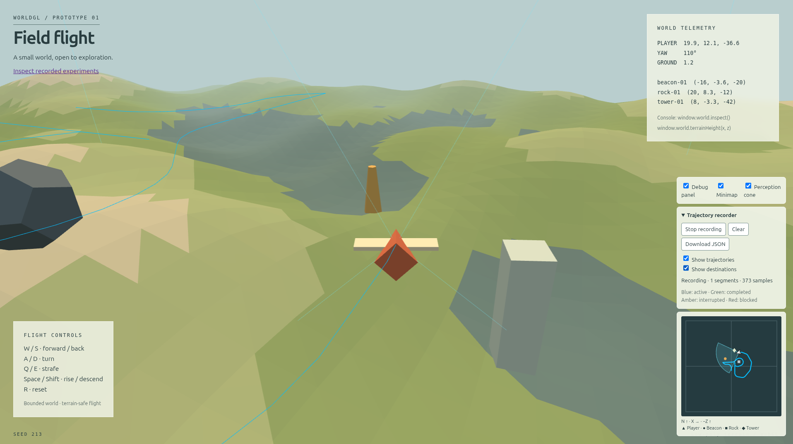
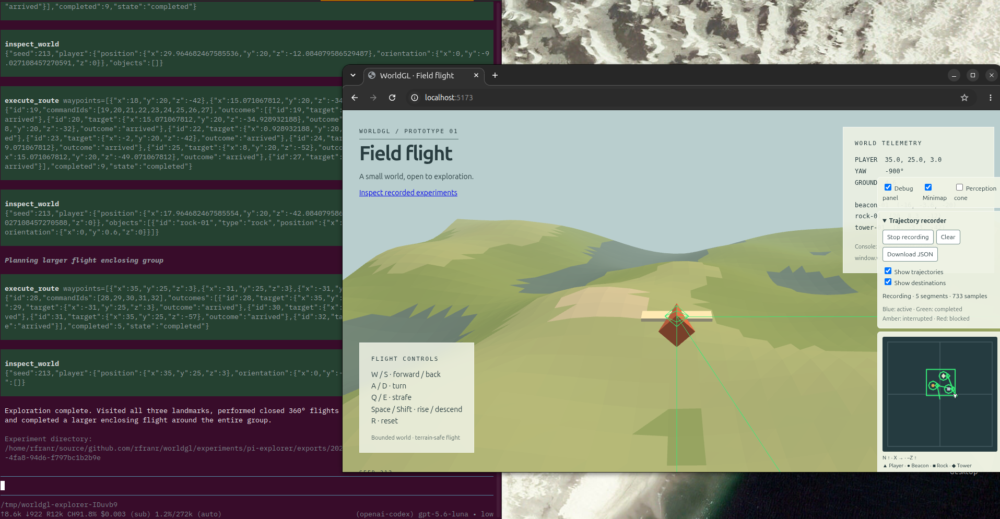

# WorldGL

WorldGL is a local Three.js + TypeScript flight prototype and a small
experimental environment for studying agent navigation through structured tools.
It includes a browser simulation and a local experiment inspector.
The simulation needs no backend or runtime network service; the optional Pi
experiment uses your configured model provider.

WorldGL explores how AI agents interact with a shared environment through constrained interfaces. The goal is to experiment with different levels of perception, available tools, and navigation semantics, observing how these constraints influence agent behavior. The world remains the same, but what an agent can perceive and do may differ.



*WorldGL’s flight environment, with terrain, landmarks and live telemetry.*

## Implemented today

- Deterministic low-poly terrain, a geometric craft and three initial landmarks.
- Desktop keyboard flight, following camera, terrain clearance and live telemetry.
- Structured inspection with distance and horizontal/vertical field-of-view limits.
- Asynchronous movement, queued destinations, routes and explicit cancellation.
- Optional trajectory recording, JSON export, 3D paths and a persistent minimap.
- Local session/trajectory import, multi-run comparison and evidence pinning.
- An optional isolated-tool Pi adapter for model-driven exploration.

This is direct velocity control, not a physics simulation. Landmarks have no
collision response. There is no world wrapping, imported-model pipeline,
persistent world storage or object-editing UI.

## Quickstart

Requires Node.js 20.19+ or 22.12+ and a modern WebGL-capable desktop browser.
From a checkout:

```sh
npm ci
npm run dev
```

Open the URL printed by Vite (normally http://localhost:5173).
Use **W/S** to fly, **A/D** to turn, **Q/E** to strafe,
**Space/Shift** to rise/descend and **R** to reset.
Click back into the scene after using debug controls to resume keyboard flight.

Open the HUD's **Inspect recorded experiments** link, or `/inspector.html`,
to load local extracted JSON/JSONL artifacts. Imports stay in the browser.
Deploy only the built `dist/` directory, never the repository root.

## Agent-driven navigation

The optional [Pi explorer](experiments/pi-explorer/README.md) connects your
configured model to WorldGL through a restricted set of tools. The agent uses
`inspect_world` for perception-limited observations, requests movement with
`move_to` or `execute_route`, and reads navigation status to check progress.
Tool requests express intended actions; returned outcomes report execution.



*Pi tool calls and returned route outcomes alongside the WorldGL scene.
The agent's completion statement is not an independent evaluation of exploration success.*

## Development checks

```sh
npx playwright install chromium # explicit browser provisioning, including CI
npm run check:report            # lint, tests, build, complexity and architecture
npm run preview                 # serve the built production bundle
```

The suite includes real Chromium interaction regressions and adapter unit tests.
Passing tests do not establish agent exploration quality or visual usability.
See [validation and evidence](docs/validation.md) for the inspected results,
limitations and untested hypotheses.

## Documentation

- [Simulation, controls, APIs and trajectory reference](docs/reference.md)
- [Inspector and comparison workflow](docs/inspector.md)
- [Pi explorer setup and exports](experiments/pi-explorer/README.md)
- [Queue and route semantics](experiments/pi-explorer/NAVIGATION.md)
- [Validation, quality checks and evidence boundaries](docs/validation.md)
- [Engineering journal](docs/journal/README.md) — experiments, discoveries and open questions

For changes, preserve public APIs and follow [agent/development guidance](AGENTS.md).
No license file is currently provided in this repository.
