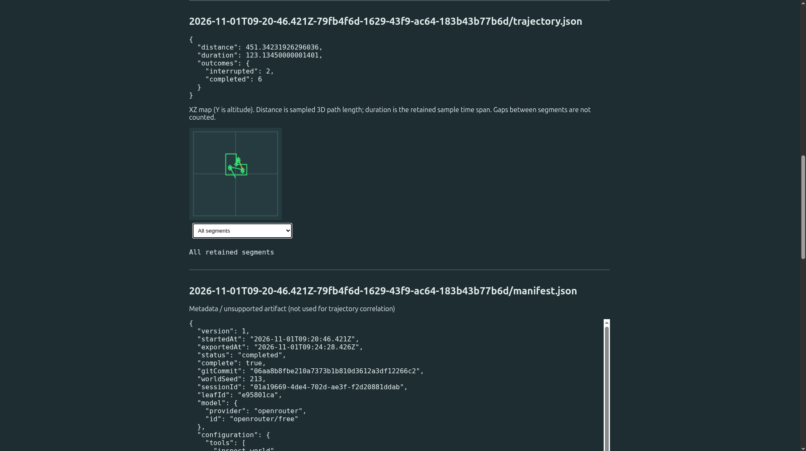
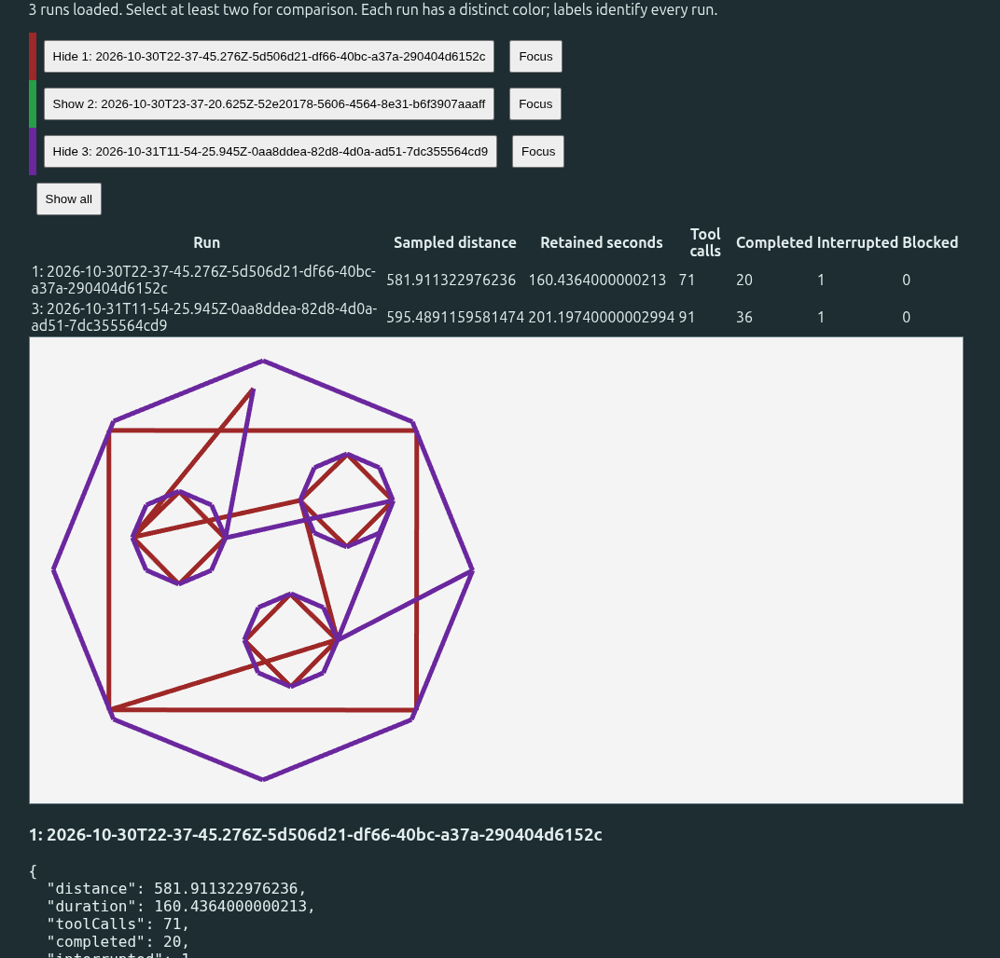
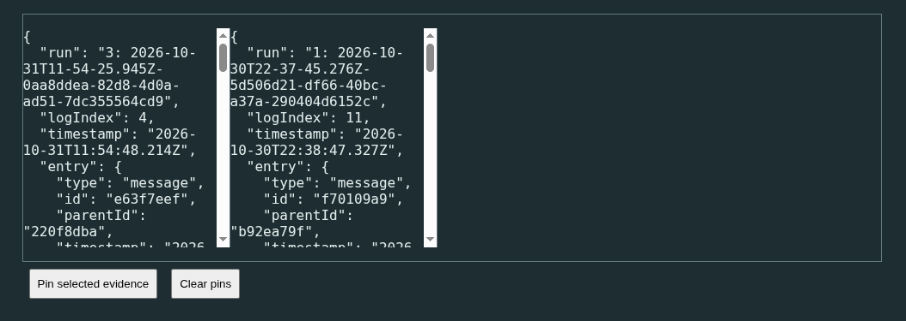

# Inspect and compare local experiments

[Documentation home](../README.md)

## Open an export

1. Start WorldGL and follow **Inspect recorded experiments**, or open `/inspector.html`.
2. Choose an extracted directory or individual JSON/JSONL files. ZIP archives and HTML session exports are not supported; extract archives first.
3. Read the import warnings and summary, then select session entries or trajectory segments to inspect the recorded data.

*Inspect retained trajectory measurements and paths; use the segment selector to examine individual commands and outcomes.*

Imports are processed locally, with a 20 MiB per-file limit. Imported text is escaped, never executed, and cannot control the live simulation. Missing files are allowed; malformed JSONL lines are skipped with warnings, while invalid trajectories are rejected. See [supported formats and retention](reference.md#experiment-inspector).

## Compare runs

In **Compare experiments**, add each export separately, or select a parent directory containing exports. Each directory becomes a separate run; loose files in a single selection form one run. Imports are additive.

- Use **Hide**, **Show**, **Focus** or **Show all** to choose visible runs.
- Inspect the overlaid XZ paths and the per-run measurement table.
- Select a segment, navigation event or session event to see its full evidence.
- Use **Pin selected evidence** to retain choices side by side; **Clear pins** removes them.

For example, load two exports of the same mission, select a destination command in each run and pin both. Compare their recorded arguments and outcomes. Check the manifests and prompts yourself for compatible seeds, missions and coordinate frames before interpreting a path difference.

*Compare retained paths and sampled measurements, using visibility controls to choose which runs to display.*

*Pin recorded evidence side by side; pins are human-selected comparisons, not proof that events correspond.*

## Interpretation boundaries

The table reports sampled 3D movement within segments, retained sample span, tool-call counts and recorded trajectory outcomes. It does not reconstruct gaps, discarded samples or total wall-clock experiment duration. Missing measurements are unavailable, not zero; history may be truncated or stale.

Session logs retain entry order, including branches. Navigation timelines use independent simulation seconds. No shared tool-call ID or synchronized clock links a session call to a trajectory segment, and no automatic alignment links different runs. Associations remain unknown rather than being guessed from command order or matching arguments.

Pins are human-selected comparisons, not proof that events correspond. A tool request is not evidence that its action succeeded. An agent's explanation is a recorded statement, not an observed causal mechanism. Differences identify questions for investigation, not demonstrated model rankings.

For producing exports and reviewing sensitive transcript content, see [Pi explorer exports](../experiments/pi-explorer/README.md#export-and-inspect).
